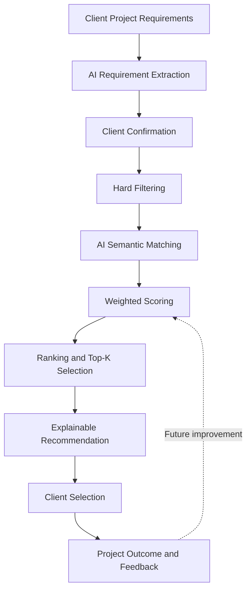
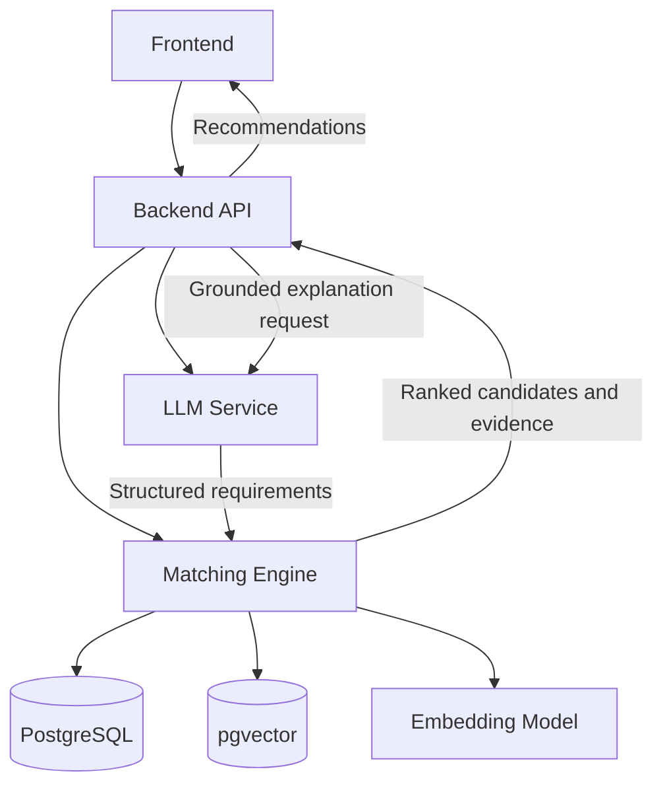
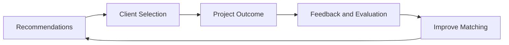

# Hybrid AI Matching System

## 1. Overview

Sistem merekomendasikan freelancer yang sesuai dengan kebutuhan proyek klien berdasarkan skill, pengalaman, portofolio, anggaran, ketersediaan, dan reliabilitas. Klien tetap menjadi pengambil keputusan akhir.

Pendekatan yang digunakan adalah **Hybrid AI Matching System**: kombinasi rule-based filtering, semantic matching, weighted scoring, dan explainable recommendation. AI memahami konteks, sementara matching engine mengendalikan kelayakan, skor, dan ranking secara terukur.

## 2. System Workflow



## 3. Data Requirements

| Client Project | Freelancer Profile |
|---|---|
| Project description | Skills |
| Required skills | Work experience |
| Preferred skills | Portfolio |
| Budget | Hourly/project rate |
| Deadline | Availability |
| Experience level | Rating and reviews |
| Project category | Completed projects |
| Expected deliverables | Specialization |

Data portofolio dan riwayat proyek menjadi bukti pendukung kompetensi. Skill yang diklaim tidak otomatis dianggap terverifikasi. Data yang tidak tersedia dibedakan dari data yang menunjukkan ketidakcocokan.

## 4. Matching Pipeline

### 4.1 AI Requirement Extraction

LLM mengubah deskripsi natural language menjadi data terstruktur, membedakan mandatory requirements dan preferred requirements.

Contoh input:

> Saya membutuhkan freelancer untuk membuat website e-commerce fashion menggunakan React. Budget maksimal Rp10 juta, pengerjaan 1 bulan, dan diutamakan yang pernah mengerjakan e-commerce sebelumnya.

Contoh output:

```json
{
  "project_type": "E-commerce Website",
  "required_skills": ["React", "Web Development"],
  "preferred_experience": ["E-commerce"],
  "industry": "Fashion",
  "max_budget": 10000000,
  "currency": "IDR",
  "duration_days": 30
}
```

Backend memvalidasi output berdasarkan schema. Klien mengonfirmasi hasil ekstraksi dan melengkapi informasi yang belum jelas. AI tidak boleh mengarang persyaratan.

### 4.2 Hard Filtering

Database query menyaring kandidat berdasarkan persyaratan wajib yang dapat diverifikasi, seperti batas anggaran, ketersediaan selama proyek, dan mandatory skills. Gunakan estimasi biaya proyek yang sebanding dengan budget; hourly rate saja tidak cukup.

Contoh simulasi:

| Tahap | Jumlah kandidat |
|---|---:|
| Total freelancer | 1.000 |
| Memenuhi budget | 650 |
| Memenuhi availability | 320 |
| Memenuhi mandatory skills | 85 |

Hanya 85 kandidat yang diteruskan ke tahap berikutnya. Normalisasi sinonim skill sebelum filtering. Jika informasi wajib belum diketahui, tandai sebagai perlu konfirmasi, bukan otomatis dianggap memenuhi syarat. Jika tidak ada kandidat, tampilkan alasan dan tawarkan perubahan syarat dengan persetujuan klien.

### 4.3 AI Semantic Matching

Semantic matching mengukur relevansi makna, bukan hanya kesamaan keyword. Misalnya, freelancer yang pernah membuat online clothing store dengan React dan payment gateway lebih relevan untuk proyek e-commerce fashion daripada freelancer yang hanya pernah membuat company profile menggunakan React.

Implementasi:

1. Gunakan embedding model untuk mengubah deskripsi proyek, pengalaman, dan portofolio menjadi vector.
2. Simpan embedding freelancer di vector storage dan perbarui saat profil berubah.
3. Buat embedding kebutuhan proyek saat matching dijalankan.
4. Hitung cosine similarity antara kebutuhan proyek dan bukti pengalaman/portofolio kandidat yang lolos filtering.
5. Konversikan hasil menjadi skor relevansi menggunakan pemetaan yang konsisten dan divalidasi.

Rumus cosine similarity:

$$\operatorname{sim}(q,v)=\frac{q\cdot v}{\|q\|\|v\|}$$

Sebaiknya pengalaman dan portofolio memiliki embedding terpisah agar skor per aspek dapat dijelaskan. Similarity bukan bukti penguasaan skill maupun probabilitas keberhasilan proyek.

### 4.4 Weighted Scoring

| Parameter | Bobot awal | Dasar penilaian |
|---|---:|---|
| Skill compatibility | 30% | Kecocokan skill wajib dan tambahan, bukti kompetensi |
| Experience relevance | 25% | Relevansi pengalaman terhadap kebutuhan proyek |
| Portfolio relevance | 20% | Relevansi karya sebelumnya terhadap deliverables |
| Budget compatibility | 10% | Kesesuaian estimasi biaya dengan budget |
| Availability | 10% | Kesesuaian kapasitas dan jadwal pengerjaan |
| Rating & reliability | 5% | Review, penyelesaian proyek, ketepatan waktu |
| **Total** | **100%** | |

Setiap parameter dinilai pada skala 0–100.

$$S=0.30s_{skill}+0.25s_{experience}+0.20s_{portfolio}+0.10s_{budget}+0.10s_{availability}+0.05s_{reliability}$$

Contoh implementasi:

```python
weights = {
    "skill": 0.30,
    "experience": 0.25,
    "portfolio": 0.20,
    "budget": 0.10,
    "availability": 0.10,
    "reliability": 0.05,
}
scores = {
    "skill": 95,
    "experience": 90,
    "portfolio": 85,
    "budget": 100,
    "availability": 100,
    "reliability": 90,
}
final_score = sum(weights[k] * scores[k] for k in weights)
# 92.5
```

Bobot dapat disesuaikan dengan prioritas klien, dengan total tetap 100%. Hard filtering menentukan kelayakan; scoring menentukan tingkat kecocokan kandidat yang layak. Hindari menghitung aspek yang sama berulang tanpa alasan. Untuk data nonwajib yang belum tersedia, tampilkan keterbatasan bukti dan gunakan kebijakan missing data yang konsisten; freelancer baru tidak otomatis dianggap buruk.

### 4.5 Ranking and Explainable Recommendation

Urutkan kandidat berdasarkan final score secara descending dan ambil Top-K (misalnya 5). LLM dapat menyusun penjelasan berdasarkan bukti profil dan skor yang telah dihitung, tetapi tidak boleh mengubah skor atau mengarang pengalaman.

Contoh output ilustratif:

| Rank | Freelancer | Match score | Estimasi biaya | Alasan | Keterbatasan |
|---:|---|---:|---:|---|---|
| 1 | A — E-commerce Developer | 92.5 | Rp8.500.000 | Pengalaman e-commerce fashion, React, payment integration | Tidak ada kekurangan signifikan yang teridentifikasi |
| 2 | B — Full-stack Developer | 86 | Rp9.000.000 | Skill teknis sesuai, pengalaman e-commerce | Belum memiliki portofolio fashion |
| 3 | C — Frontend Developer | 78 | Rp6.500.000 | Skill frontend sesuai, biaya lebih rendah | Pengalaman integrasi pembayaran terbatas |

Data di atas fiktif. Match score bukan probabilitas keberhasilan proyek. Klien dapat melihat profil, rincian skor, bukti pendukung, dan memilih freelancer sendiri.

## 5. Technical Architecture



| Component | Proposed technology | Responsibility |
|---|---|---|
| Frontend | React / Next.js | Project input, confirmation, recommendation UI |
| Backend | Python / FastAPI | API orchestration, validation, authorization |
| Relational database | PostgreSQL | Profiles, projects, skills, availability, feedback |
| Vector storage | pgvector | Store and retrieve embeddings |
| Embedding model | Sentence Transformers / OpenAI Embeddings | Semantic representations |
| LLM | GPT / Gemini / Llama | Requirement extraction and grounded explanations |
| Matching engine | Custom Python logic | Filtering, scoring, ranking |

Tidak perlu melatih model sendiri untuk versi awal. PostgreSQL dan pgvector dapat berada dalam satu database. LLM dan embedding model adalah komponen yang berbeda secara fungsi.

## 6. Feedback Loop and Future Learning



Kumpulkan data kandidat yang ditampilkan, pilihan klien, hasil proyek, kepuasan, ketepatan waktu, dan kesesuaian biaya. Data historis yang cukup dapat digunakan untuk mengembangkan Learning to Rank sehingga ranking belajar dari outcome nyata.

Kandidat yang tidak dipilih belum tentu tidak kompeten. Perhatikan selection bias, exposure bias, dan cold-start freelancer baru. Evaluasi perubahan model sebelum deployment; feedback tidak otomatis mengubah model secara langsung.

## 7. Development Roadmap

| Phase | Scope |
|---|---|
| MVP | LLM extraction, hard filtering, weighted scoring berbasis skill dan data terstruktur, rekomendasi dengan alasan |
| Version 2 | Embedding dan semantic similarity untuk pengalaman dan portofolio |
| Version 3 | LLM reranking terbatas dan personalized matching, setelah dievaluasi |
| Version 4 | Learning to Rank dan feedback loop |

## 8. Evaluation Plan

Buat dataset evaluasi berisi contoh proyek dan kandidat yang dinilai manusia berdasarkan rubric kecocokan. Bandingkan keyword matching, weighted scoring, dan hybrid semantic matching.

- Precision@K: proporsi kandidat relevan dalam Top-K.
- Recall@K: proporsi kandidat relevan yang berhasil ditemukan dalam Top-K.
- NDCG@K: kualitas urutan ranking berdasarkan tingkat relevansi.
- Hard constraint violation rate: persentase rekomendasi yang melanggar persyaratan wajib terverifikasi; target nol.
- Explanation faithfulness: kesesuaian alasan dengan bukti profil.
- Latency dan biaya per matching request.

Gunakan data evaluasi terpisah dari data yang dipakai untuk tuning bobot. Uji juga kasus tanpa kandidat, profil tidak lengkap, freelancer baru, dan persyaratan ambigu.

## 9. Business Rules and Safeguards

- Keputusan akhir pemilihan freelancer berada pada klien.
- Jangan mengendurkan mandatory requirements tanpa persetujuan klien.
- Jangan menggunakan atribut pribadi sensitif yang tidak relevan untuk ranking.
- Batasi akses data CV dan portofolio serta perlakukan konten profil sebagai data, bukan instruksi bagi LLM.
- Simpan versi model, bobot, hasil filtering, dan rincian skor untuk audit dan reproduksibilitas.
- Jangan menampilkan skor sebagai jaminan keberhasilan.

## 10. Design Status and Assumptions

Dokumen ini merupakan rancangan awal, bukan implementasi yang telah diuji. Bobot, Top-K, metode normalisasi, model, teknologi, dan kebijakan missing data masih perlu divalidasi terhadap dataset dan kebutuhan pengguna. Rancangan tidak mencakup implementasi escrow atau pembayaran; fokusnya adalah subsistem AI matching.

**Prinsip utama:** AI memahami konteks dan relevansi; matching engine menentukan kelayakan, skor, dan ranking secara terukur; klien mengambil keputusan akhir.
