# Gigly Screenshots

Key pages of the main flow, in order: matching, contract, escrow, delivery, review, and arbitration.
Client and freelancer pages use the built-in demo data (`VITE_USE_MOCK=true`); arbiter pages use the real backend with a dispute raised through the app.

| # | Page | Role |
| :- | :--- | :--- |
| 1 | [Login](screenshots/01-login.png) | All |
| 2 | [Dashboard](screenshots/02-client-dashboard.png) | Client |
| 3 | [AI matching results](screenshots/03-client-ai-matches.png) | Client |
| 4 | [Invitation detail](screenshots/04-freelancer-invitation.png) | Freelancer |
| 5 | [Contract builder](screenshots/05-client-contract.png) | Client |
| 6 | [Fund escrow](screenshots/06-client-fund-escrow.png) | Client |
| 7 | [Dashboard](screenshots/07-freelancer-dashboard.png) | Freelancer |
| 8 | [Submit milestone deliverable](screenshots/08-freelancer-submit.png) | Freelancer |
| 9 | [Milestone review (approve, request revision, dispute)](screenshots/09-client-milestone-review.png) | Client |
| 10 | [Arbitration dashboard](screenshots/10-arbiter-dashboard.png) | Arbiter |
| 11 | [Verdict confirmation](screenshots/11-arbiter-verdict.png) | Arbiter |

## 1. Login
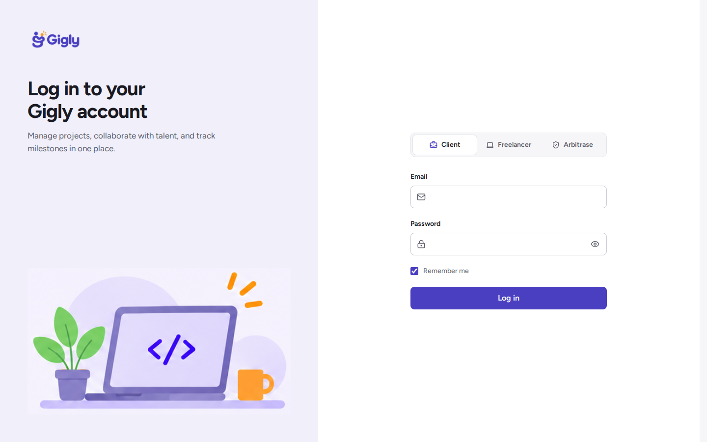

## 2. Client dashboard
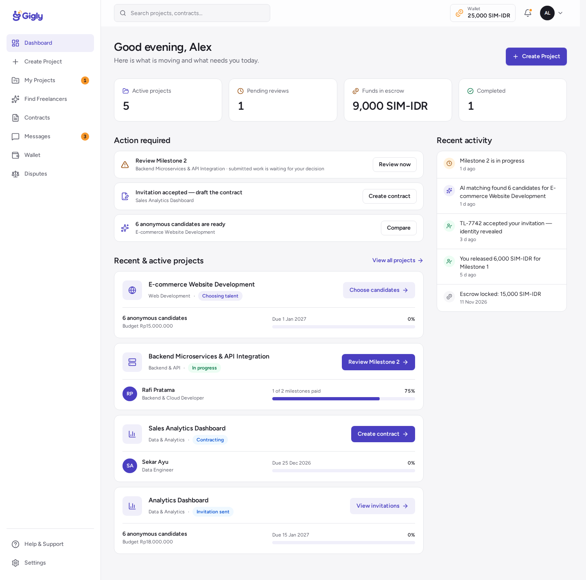

## 3. AI matching results
Candidates are ranked anonymously; identity is revealed only after the freelancer accepts an invitation.
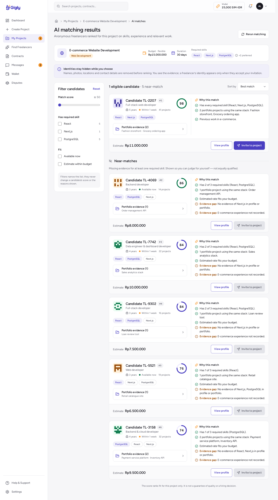

## 4. Freelancer invitation detail
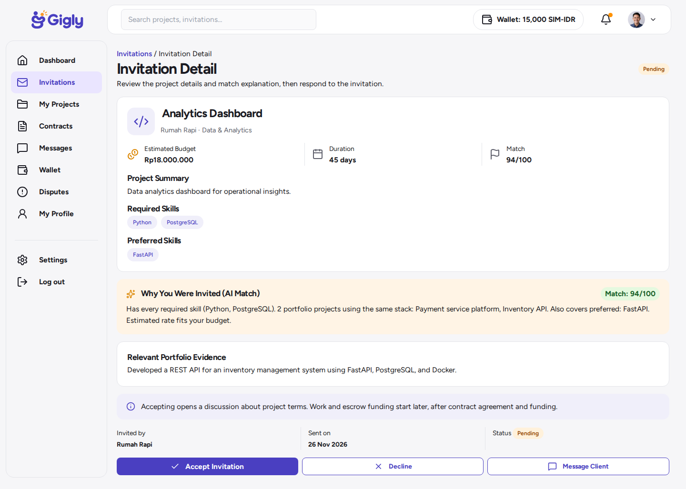

## 5. Contract builder
Scope, milestones, acceptance criteria, review period, and arbiter. The freelancer must accept the contract before funding.
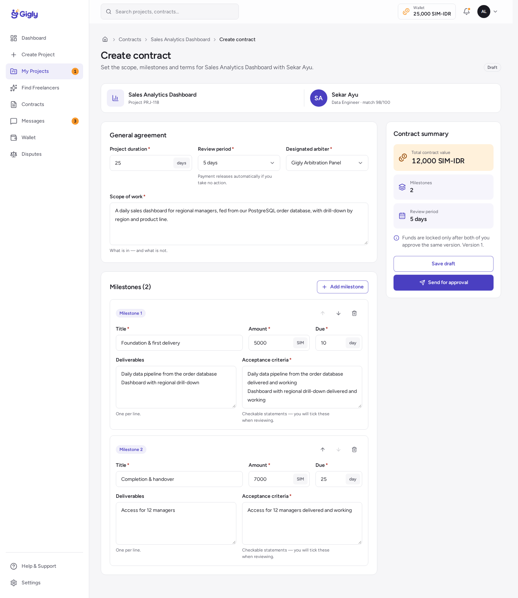

## 6. Fund escrow
The full contract value is locked in `Escrow.sol` before work starts.
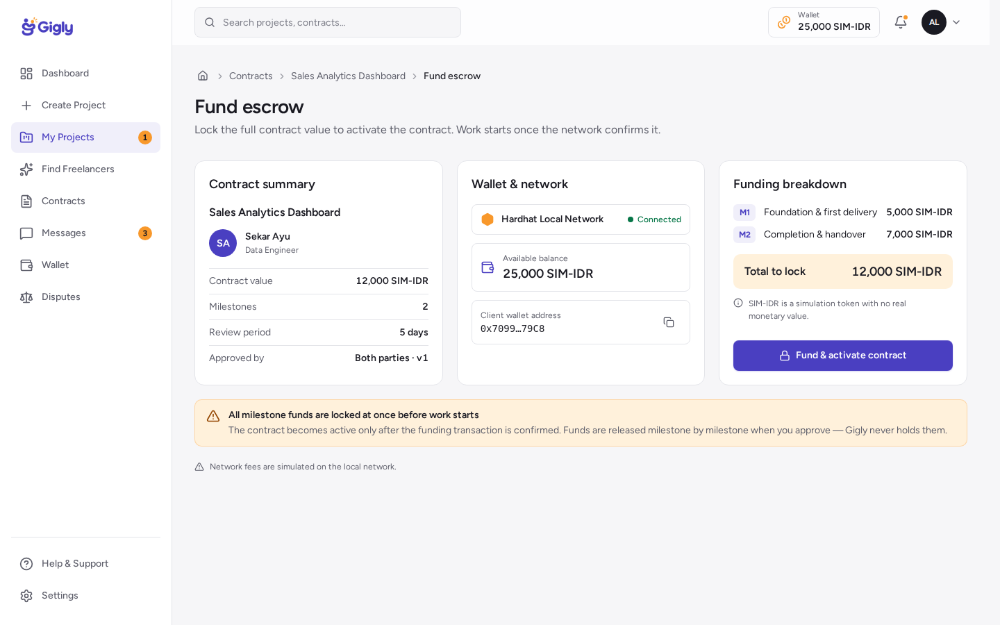

## 7. Freelancer dashboard
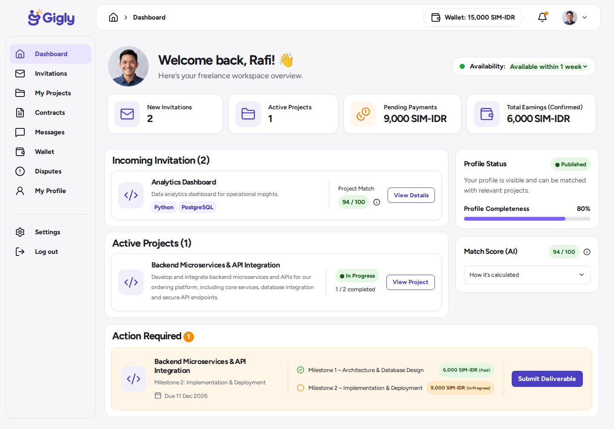

## 8. Submit milestone deliverable
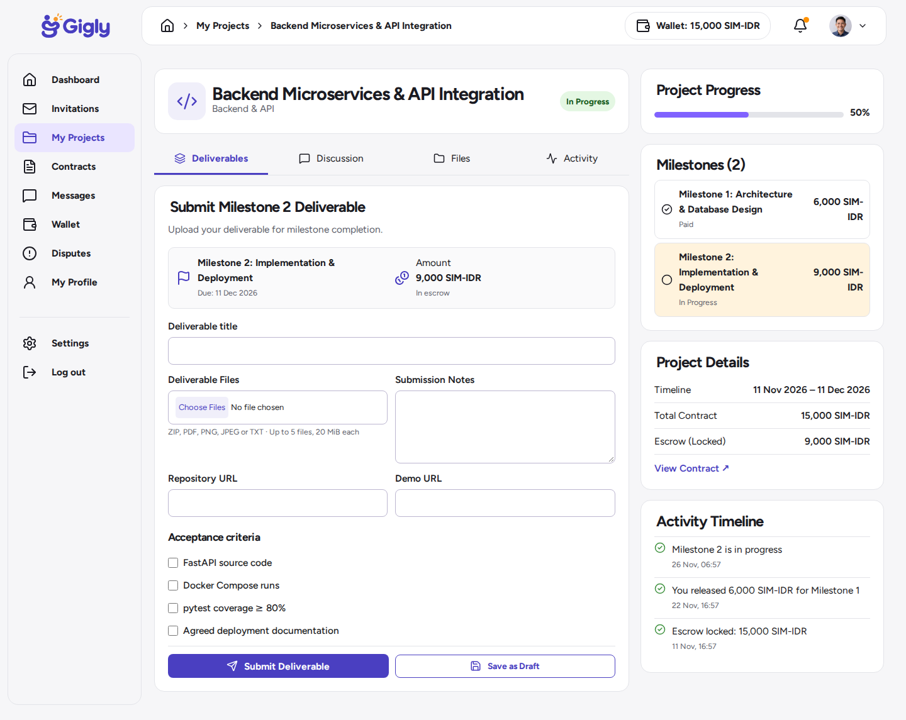

## 9. Milestone review
The client approves (payment released), requests a revision, or raises a dispute after a revision is still rejected.
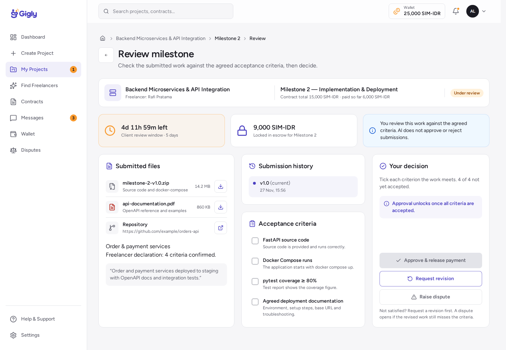

## 10. Arbitration dashboard
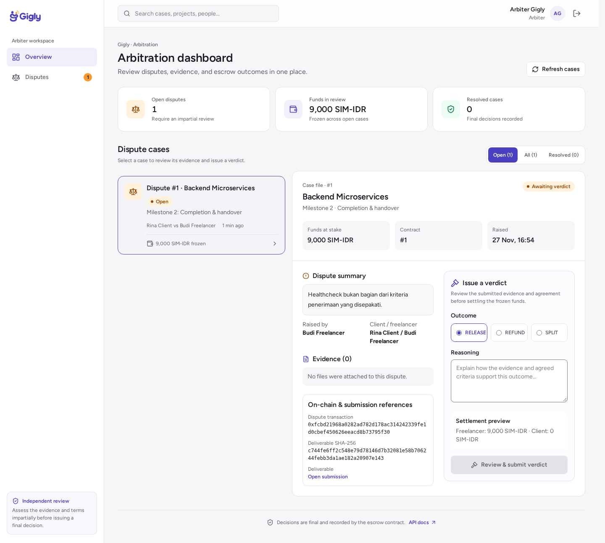

## 11. Verdict confirmation
`RELEASE`, `REFUND`, or `SPLIT` is executed on the escrow contract.
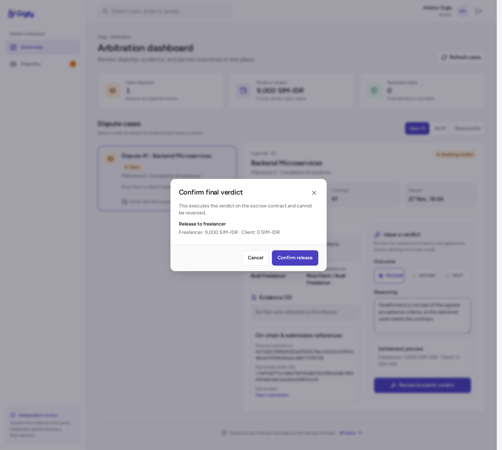
